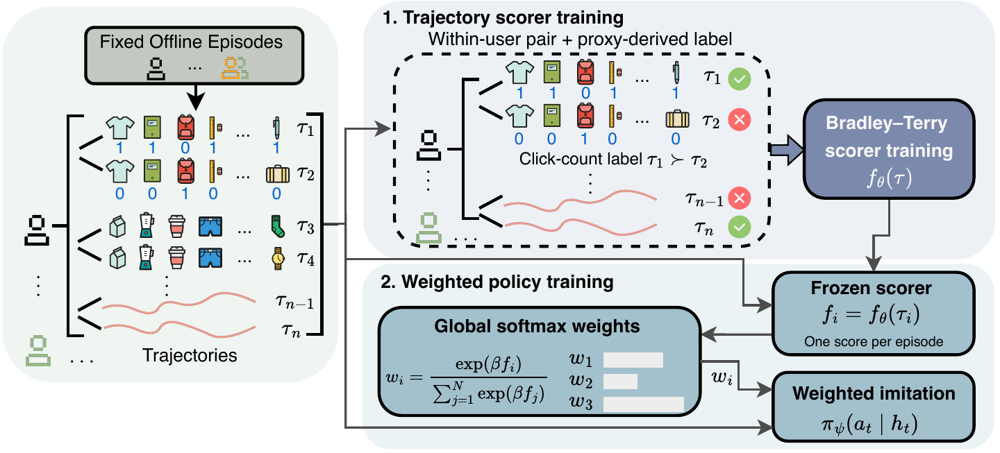

# PrDT4Rec

PrDT4Rec is an offline recommendation method that learns from preferences between logged trajectories. It first trains a Bradley–Terry scorer on trajectory pairs, then converts the frozen scores into trajectory weights for training a Decision ConvFormer policy. The inverse-temperature parameter β controls how strongly training emphasizes higher-scoring trajectories.

This repository provides model implementations, dataset configurations, data preparation tools, and training and evaluation commands for MovieLens, KuaiRec, Coat, YahooR3, KuaiRand, and VirtualTB.



## Install

Use Python 3.11 or later and install a PyTorch build appropriate for your hardware.

```sh
python -m pip install -e '.[dev]'
python -m prdt4rec list
python -m pytest
```

For upstream benchmark environment and dataset setup, see the [EasyRL4Rec repository and setup instructions](https://github.com/chongminggao/EasyRL4Rec).

## Configuration

[configs/prdt.json](configs/prdt.json) contains the dataset configurations for MovieLens, KuaiRec, Coat, YahooR3, KuaiRand, and VirtualTB. Use `--config` to supply an edited copy.

## Train and evaluate

Prepare a data bundle using [docs/DATA.md](docs/DATA.md), then run:

```sh
python -m prdt4rec check --profile coat --data-root ./data/coat --dry-run
python -m prdt4rec prepare --profile coat --data-root ./data/coat --output-root ./outputs/coat/seed0 --seed 0
python -m prdt4rec scorer --profile coat --data-root ./data/coat --output-root ./outputs/coat/seed0 --seed 0 --device cuda
python -m prdt4rec policy --profile coat --data-root ./data/coat --output-root ./outputs/coat/seed0 --seed 0 --device cuda
python -m prdt4rec evaluate --profile coat --data-root ./data/coat --output-root ./outputs/coat/seed0 --seed 0 --device cuda
```

Use the profile names from `python -m prdt4rec list`. Use a separate output directory per seed and resume with the same inputs and `resume --through evaluate`. VirtualTB evaluation also takes `--simulator-root`. Evaluation uses frozen policies, matched development cases, native stopping, and a 30-step cap.

Tests use synthetic data. Benchmark data, response models, baseline implementations, and experimental outputs are external to this release. See [NOTICE.md](NOTICE.md) and [LICENSE](LICENSE).
